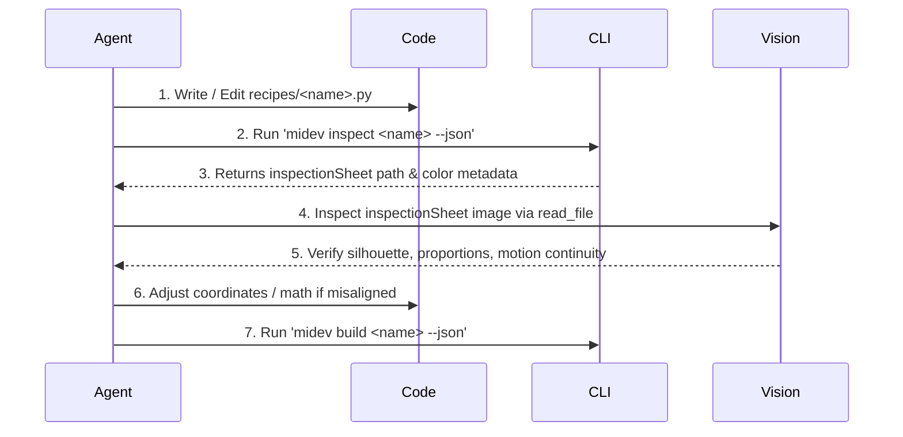

# AI Agent Operational Rules for midev-tools

This document provides system rules, operational guidelines, and API specifications for autonomous AI coding agents (Claude, Cursor, Antigravity, Copilot, Windsurf, Devin) working within the `midev-tools` repository.

---

## 1. Core Principles

1. **Deterministic Python-First**: All game assets must be generated via pure Python scripts. Do NOT generate binary PNGs directly or use external graphics software.
2. **Strict Quality Contracts**:
   - **0 Palette Bleeds**: All pixel colors must belong strictly to the active palette.
   - **100% Binary Alpha**: Transparency must be binary (alpha channel strictly `0` or `255`). Never produce semi-transparent blurred pixels.
   - **Uniform Frame Multiples**: Spritesheet dimensions must be exact multiples of `frameWidth` and `frameHeight`.
3. **Dual Audience Respect**:
   - Keep Python code clean, readable, well-commented, and maintainable for human developers.
   - Always prefer standard library and provided `pixelkit` primitives.

---

## 2. Recipe Authoring Standards

Every art asset lives in `recipes/<name>.py` inside the active project directory (`projects/<game_name>/recipes/` or `samples/fisharium/recipes/`).

### Standard Recipe Template
```python
from pixelkit import Canvas, SheetBuilder, bob, swing

def build(ctx):
    # 1. Initialize SheetBuilder with frame geometry and origin
    # Origin is the feet/pivot anchor: (width // 2, height - 2) for humanoid sprites
    sb = SheetBuilder("hero", 32, 32, origin=(16, 28))

    # 2. Build Animation Tracks
    idle_frames = []
    for f in range(4):
        c = Canvas(32, 32)
        dy = bob(f, 4, amp=1.0) # Vertical bounce
        # Draw layers from back to front
        c.rect(12, 12 + dy, 8, 12, "dark_blue", fill=True) # Torso
        c.circle(16, 8 + dy, 4, "peach", fill=True)        # Head
        c.outline("black")                                 # 1px crisp outline
        idle_frames.append(c)

    sb.add("idle", idle_frames, fps=6, loop=True)

    # 3. Export Targets
    sb.save(ctx.sprites)        # Compiles spritesheet + Godot .tres + TexturePacker JSON
    sb.preview_gif(ctx.preview)  # Generates animated GIF preview
```

### Destination Routing
Use the appropriate `ctx` destination folder:
- Character & NPC sprites: `ctx.sprites`
- Autotiles & terrain: `ctx.tiles`
- HUD, dialogs, buttons, slots: `ctx.ui`
- Parallax & scenic backdrops: `ctx.backgrounds`

---

## 3. Autonomous Multimodal Verification Loop

When creating or modifying an art recipe, agents should self-verify their output using the multimodal inspection engine:



1. Run visual inspection:
   ```bash
   python midev.py inspect <recipe_name> --json
   ```
2. Read the resulting `inspectionSheet` image using your vision tool (e.g. `read_file`).
3. Check the annotated sheet:
   - Are the limbs and facial features proportional?
   - Is the origin crosshair `(ox, oy)` positioned at the ground contact point?
   - Is motion smooth across the frame index strip (`#0`, `#1`, `#2`...)?
   - Are palette badges green (`0 bleeds`, `100% Binary Alpha`)?
4. If adjustments are needed, tweak pixel offsets in code and re-inspect until perfect!

---

## 4. MCP Server Integration (Cursor / Claude / Antigravity)

When connected via Model Context Protocol:
- Start stdio server: `python midev.py mcp`
- Available MCP Tools:
  - `midev_list_recipes`: Discover all existing recipes in project.
  - `midev_build_recipe`: Compile recipes to spritesheets.
  - `midev_inspect_recipe`: Generate annotated inspection sheet for vision review.
  - `midev_validate_assets`: Run quality gate checks (palette & alpha).
  - `midev_get_canvas_docs`: Retrieve `pixelkit.Canvas` function signatures.
  - `midev_switch_project`: Switch active workspace.
  - `midev_generate_template`: Scaffold new character, autotile, vfx, or ui recipes.

---

## 5. Machine-Readable CLI Reference

Always append `--json` when invoking commands programmatically:
```bash
python midev.py build [name] --json
python midev.py inspect <name> --json
python midev.py validate --json
python midev.py list --json
python midev.py doctor --json
python midev.py info --json
python midev.py project list --json
python midev.py palette inspect <name> --json
```
