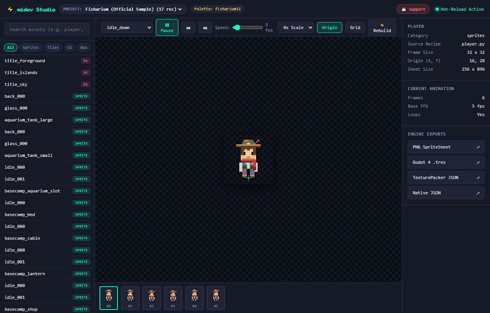

# midev-tools: Code-Generated Game Art Asset Toolkit

[](https://python.org)
[](https://github.com/mikhaprive-flows/midev-tools/actions/workflows/ci.yml)
[](#)
[](tools/art/mcp_server.py)
[](https://ko-fi.com/midevfish)
[](https://trakteer.id/MiDevFish)
[](tools/art/)

[English](README.md) | **Bahasa Indonesia**

`midev-tools` adalah toolkit modular dan mandiri untuk pembuatan aset pixel art dan grafis vektor pada pengembangan game 2D berbasis kode.
Dibangun dengan **Arsitektur Dual-Audience**: tangguh dan ringan untuk **programmer** yang menulis kode secara manual, serta dioptimalkan secara bawaan untuk **vibe coder & AI coding agent** (Claude, Cursor, Antigravity, Windsurf) melalui protokol MCP dan verifikasi visual multimodal.

> [!NOTE]
> **Masih dalam Pengembangan (Work in Progress)**: Toolkit ini belum sempurna dan masih aktif dikembangkan. Fitur, API, dan generator prosedural terus berevolusi secara berkala. Masukan, laporan bug, dan saran kontribusi sangat kami nantikan!

---

## ⚡ Live Preview Studio

Dashboard web interaktif waktu-nyata yang dilengkapi kontrol pemutaran animasi, *scrubbing* frame-strip pada timeline, inspeksi titik pivot/tumpu piksel (*origin*), peralihan antar-proyek, serta *hot-reloading* instan via SSE:



---

## 🎮 Asset Showcase: `player` Character Rig

Setiap sprite, frame animasi, dan garis luar (*outline*) digenerate 100% secara deterministik dari kode di [`samples/fisharium/recipes/player.py`](samples/fisharium/recipes/player.py). Ayunan anggota gerak matematis, offset pantulan prosedural (*bob*), dan outline palet selektif memastikan gerakan retro-pixel tetap halus dan konsisten.

| Idle (Down) | Walk Cycle | Run Cycle | Dash / Dodge | Dig Action | Fishing Catch |
| :---: | :---: | :---: | :---: | :---: | :---: |
|  |  |  |  |  |  |

---

## ⚖️ Mengapa Art Berbasis Kode? (Keunggulan Dual-Audience)

| Fitur | AI Tradisional (Midjourney/SD) | Gambar Manual (Aseprite) | **midev-tools (Dual-Audience)** |
| :--- | :--- | :--- | :--- |
| **Untuk Programmer** | ❌ Piksel acak, tanpa kontrol kode | ⏱️ Berjam-jam menggeser piksel manual | ✅ **100% Kode Python & Matematika (`API_REFERENCE.md`)** |
| **Untuk AI Agent** | ⚠️ Bergantung pada undian prompt | ❌ Agent tidak bisa menggunakan GUI mouse | ✅ **Resep Python native + MCP Server (`AGENTS.md`)** |
| **Gaya & Palet** | ❌ Warna blur & bleed inkonsisten | ✅ Konsistensi terjaga manual | ✅ **Penyesuaian deterministik ketat (0 bleeds)** |
| **Metadata Engine** | ❌ Nihil (PNG mentah tanpa frame data) | ⚠️ Pemotongan & tagging manual | ✅ **Otomatis .tres Godot 4, TexturePacker, Slices** |
| **Version Control** | ❌ Binary blob mengotori Git | ❌ File biner `.ase` / `.psd` | ✅ **Skrip Python teks biasa yang mudah di-diff di Git PR** |
| **Feedback Visual** | ⏱️ Reroll puluhan kali | ⏱️ Iterasi manual lambat | ⚡ **Inspeksi Multimodal (`midev inspect`) dalam hitungan detik** |

---

## 🎨 Catatan tentang Belajar Art & Prototyping Cepat

> **Kami sangat mendorong setiap pengembang game untuk terus belajar dan berlatih membuat karya seninya sendiri.**

Mempelajari seni pixel art tradisional, teori warna, desain siluet, dan timing animasi (menggunakan software hebat seperti Aseprite, Libresprite, atau Krita) adalah keterampilan berharga yang tak tergantikan. Tidak ada yang bisa menandingi visi artistik orisinal dan sentuhan ekspresi pribadi dalam pembuatan sebuah game.

**Namun, waktu sering kali menjadi sumber daya paling terbatas bagi pengembang indie.**

Saat Anda harus membagi fokus antara logika mekanika game, arsitektur engine, sistem fisika, efek suara, dan alur cerita, Anda mungkin tidak memiliki waktu berjam-jam atau berminggu-minggu untuk menggambar manual rig karakter dengan 12 arah/track, 47 canonical autotile, 9-slice UI kit, dan partikel VFX hanya demi memvalidasi sebuah konsep ide.

**`midev-tools` hadir sebagai kerangka dasar (*base frame*) dan pondasi prototyping Anda:**
- **Mulai Cepat Prototipe Anda**: Dapatkan spritesheet yang rapi, sesuai palet warna, dan siap pakai langsung di engine (Godot `.tres`, TexturePacker JSON, potongan frame PNG) sejak hari pertama.
- **Fokus pada Gameplay Terlebih Dahulu**: Uji dan sempurnakan gameplay loop inti, collision boundary, dan mekanika kontrol Anda tanpa terhambat ketiadaan aset visual.
- **Kembangkan dan Ganti Kapan Saja**: Karena seluruh aset yang digenerate mematuhi ukuran frame yang seragam, titik pivot (*origin*) yang pasti, dan aturan palet warna yang ketat, Anda dapat memperlakukannya sebagai pondasi bersih—lalu menyesuaikan resep Python atau menggantinya dengan art buatan tangan Anda di kemudian hari tanpa merusak pengaturan engine Anda!

---

## Fitur Utama
- **100% Pure Python**: Sepenuhnya lintas platform (Windows, Linux, macOS) dengan bootstrap virtual environment otomatis tanpa ketergantungan skrip OS-shell.
- **Arsitektur Multi-Project Workspace**:
  - Workspace game terisolasi (`projects/<game_name>/`) yang terpisah dari referensi sample resmi (`samples/fisharium/`).
  - Pergantian proyek mudah melalui CLI (`midev project use`) maupun dropdown langsung di Web Studio.
- **Library Generator Art Prosedural** (`tools/art/generators/`):
  - **Character**: Rig humanoid parametrik (12 track: idle, walk, attack, hurt × 3 arah hadap).
  - **Autotile**: Set Wang blob 47 tile (bitmask minimal 3x3 untuk Godot 4 & Tiled).
  - **VFX**: Ledakan radial, riak air (ripple), tebasan melengkung (slash), dan kilau sihir (sparkle).
  - **UI Kit**: Panel 9-slice, bilah stat HP/MP, slot inventaris, dan tombol efek 3D.
- **Resep Python Deterministik**: Tulis animasi karakter, tileset, dan antarmuka UI sebagai skrip Python murni yang dapat di-diff dengan mudah.
- **Dual Pipeline (Raster & Vektor)**:
  - *Raster*: API `Canvas` (`pixelkit.py`) untuk sprite karakter, frame sweep, dithering, dan outline selektif 1 piksel.
  - *Vektor*: Rendering SVG (`resvg-py`) untuk prop geometris tajam, bingkai antarmuka, dan background berlapis.
- **Exporter Engine Universal**:
  - **Godot 4**: Menghasilkan native `SpriteFrames` (`.tres`) siap pakai untuk `AnimatedSprite2D`.
  - **TexturePacker JSON**: Format standar Hash/Array untuk Phaser, PixiJS, Unity, dan Raylib.
  - **PNG Slices**: Urutan frame individual untuk alur kerja Aseprite dan frame-by-frame.
- **Alat Pembuat Ikon Multi-Resolusi & Pengujian**:
  - Export format `.ico` multi-resolusi Windows (`Canvas.save_ico()`) mendukung (16x16, 32x32, 48x48) dengan downscaling nearest-neighbor yang tajam.
  - Generator favicon studio (`python midev.py icon`) dan suite pengujian otomatis bawaan (`python midev.py test`).
- **Multi-Palette & Penerapan Tema Prosedural**:
  - Mendukung file `.hex`, `.gpl` (GIMP/Aseprite), dan `.pal`.
  - Preset bawaan: PICO-8, DB32, Endesga 32, Game Boy DMG, dan Fisharium 32.
  - Pewarnaan ulang instan (`c.recolor()`), efek pencahayaan (*lighting tint*) (`c.tint()`), dan gradasi warna (`make_ramp()`).
- **File Watcher Interaktif & Cache Build Inkremental**:
  - File watcher otomatis me-render ulang dan memvalidasi dalam hitungan milidetik saat file disimpan di editor kode.
  - Content-addressed caching berbasis SHA-256 melompati resep yang tidak berubah untuk proses build secepat kilat.

---

## Panduan Memulai Cepat (Quick Start)

### 1. Setup Environment
Memerlukan Python 3.12+.
```bash
python midev.py setup
```
*Catatan: `midev.py` secara otomatis mendeteksi dan berjalan di dalam `tools/.venv`. Anda tidak perlu mengaktifkan virtual environment secara manual.*

Opsional: Pasang sebagai perintah CLI langsung:
```bash
pip install -e .
# Sekarang Anda dapat langsung mengetik 'midev build' dari mana saja di dalam repositori!
```

### 2. Manajemen Workspace & Proyek
```bash
# Tampilkan daftar seluruh proyek dan sample yang terdaftar
python midev.py project list

# Buat workspace proyek game baru
python midev.py project create my_rpg --palette pico8 --template rpg

# Ganti proyek aktif
python midev.py project use my_rpg

# Tampilkan informasi proyek aktif atau proyek tertentu
python midev.py project info
```

### 3. Generator Aset Prosedural
```bash
# Generate rig karakter humanoid (hero)
python midev.py generate character --name hero

# Generate set autotile Wang blob 47 tile untuk Godot / Tiled
python midev.py generate autotile --name dungeon_tiles

# Generate animasi pixel VFX (explosion, ripple, slash, sparkle)
python midev.py generate vfx --name magic_fx

# Generate kit UI (panel 9-slice, bilah status, slot inventaris, tombol)
python midev.py generate ui --name hud_kit
```

### 4. Perintah Build & Export
```bash
# Tampilkan daftar seluruh resep di proyek aktif
python midev.py list

# Build satu resep spesifik
python midev.py build player

# Build seluruh resep di proyek aktif
python midev.py build

# Build inkremental (hanya memproses resep yang berubah)
python midev.py build --incremental

# Paksa build ulang seluruh resep mengabaikan cache
python midev.py build --force

# Export ke format engine tertentu (godot, texturepacker, slices, native, all)
python midev.py build player --format godot
python midev.py build player --format texturepacker
python midev.py build player --format slices
python midev.py build player --format all

# Export langsung ke direktori engine game eksternal
python midev.py build --out "F:/MyGodotGame/assets/sprites" --format godot

# Bersihkan direktori output sebelum melakukan build
python midev.py build --clean

# Live Interactive Preview Studio (Web UI dengan kontrol animasi & hot-reload)
python midev.py studio
python midev.py studio --port 8080
python midev.py studio --no-open

# Live File Watcher (otomatis build & validasi ulang saat file disimpan)
python midev.py watch
python midev.py watch player

# Lembar Verifikasi Visual Multimodal (untuk review pengembang dan AI agent vision)
python midev.py inspect player
python midev.py inspect player --scale 4
python midev.py inspect player --json

# Jalankan Model Context Protocol (MCP) Server untuk Cursor / Claude Desktop / Antigravity
python midev.py mcp

# Jalankan suite pengujian otomatis
python midev.py test

# Output terstruktur ramah mesin (ideal untuk skrip & autonomous agent)
python midev.py build --json
python midev.py list --json
python midev.py doctor --json
python midev.py project list --json

# Buat / perbarui favicon studio .ico
python midev.py icon

# Diagnostik sistem & info proyek
python midev.py doctor
python midev.py info

# Manajemen & inspeksi palet warna
python midev.py palette list
python midev.py palette inspect pico8
python midev.py palette inspect dawnbringer32

# Build menggunakan palet tertentu (pico8, dawnbringer32, endesga32, gameboy4, fisharium32)
python midev.py build player --palette pico8
python midev.py build player --palette gameboy4

# Validasi kualitas aset yang dihasilkan (cek bleed & alpha)
python midev.py validate
```

### 5. Dokumentasi & Panduan Agent
- 📖 [**Manual Programmer API Reference**](docs/API_REFERENCE.md): Panduan lengkap `pixelkit.Canvas`, `SheetBuilder`, fungsi matematika, dan pipeline SVG.
- 🤖 [**AI Agent Rules & Protocol**](AGENTS.md): Pedoman ketat dan siklus verifikasi multimodal untuk coding agent otonom.
- 🎯 [**Konfigurasi Cursor**](.cursorrules): Integrasi langsung file `.cursorrules`.

### 6. Manajemen Git
```bash
python midev.py git status
python midev.py git info
python midev.py git sync -m "feat: add player fishing animation"
```

---

## Struktur Direktori
```
midev_art_tools/
├── midev.py                  # CLI runner utama murni Python (auto-venv bootstrapper)
├── pyproject.toml            # Konfigurasi paket Python standar PEP 621
├── config/
│   └── midev.config.json     # Konfigurasi pipeline global
├── samples/
│   └── fisharium/            # Proyek sample referensi resmi
│       ├── config.json       # Konfigurasi proyek sample
│       └── recipes/          # Resep sample (player, chest, terrain, dll.)
├── projects/                 # Workspace terisolasi untuk proyek game pengguna
│   └── demo_rpg/             # Contoh proyek RPG prosedural
├── tests/                    # Suite pengujian otomatis (test_ico.py, dll.)
├── tools/
│   ├── art/                  # Mesin inti pipeline
│   │   ├── artkit.py         # Engine CLI utama
│   │   ├── pixelkit.py       # API Canvas & grafis raster
│   │   ├── palette_kit.py    # Sistem pemuat palet & recoloring
│   │   ├── projects.py       # Pengelola workspace multi-project
│   │   ├── generators/       # Library generator prosedural (character, autotile, vfx, ui)
│   │   ├── icon_gen.py       # Generator favicon multi-resolusi .ico
│   │   ├── studio.py         # Server Interactive Live Preview Studio
│   │   ├── web/              # Frontend web studio (HTML/CSS/JS/favicon.ico)
│   │   ├── watcher.py        # File watcher & mesin hot-reload
│   │   └── cache.py          # Content-addressed SHA-256 build cache
│   ├── .venv/                # Virtual environment lokal terisolasi
│   └── requirements.txt      # Dependensi pustaka Python
├── docs/
│   ├── ART_PIPELINE.md       # Arsitektur pipeline & spesifikasi gaya
│   └── images/               # Tangkapan layar dokumentasi & animasi showcase
├── README.md                 # Dokumentasi proyek (Bahasa Inggris)
└── README.id.md              # Dokumentasi proyek (Bahasa Indonesia)
```

---

## 🔒 Model Keamanan

- **Eksekusi Kode Python Dinamis**: Resep (`recipes/*.py`) adalah skrip Python yang dievaluasi secara dinamis oleh build engine. Hanya muat, inspeksi, dan build resep maupun proyek dari sumber yang Anda percayai. Jangan pernah menjalankan resep pihak ketiga yang tidak tepercaya.
- **Proteksi Server Web Studio**: Server Studio lokal berjalan ketat pada `localhost`/`127.0.0.1` dan menerapkan verifikasi token sesi wajib (`X-Midev-Token`), validasi header Host (mencegah DNS rebinding), validasi ketat Origin/CORS (mencegah CSRF dari origin eksternal atau port lokal lainnya), serta proteksi path traversal.
- **Batasan Aman Pembersihan Direktori (`--clean`)**: Pembersihan folder output dibatasi secara ketat oleh file penanda keamanan (`.midev-output`), pelacakan aset berbasis manifest, dan validasi jalur direktori. Upaya menghapus drive root, direktori home pengguna, root repositori, atau folder luar tanpa izin akan langsung diblokir secara permanen.
- **Batasan Akses MCP Server**: Server Model Context Protocol (MCP) mengekspos fungsi kepada AI agent lokal via stdio. Seluruh output aset, pembuatan template, dan validasi dibatasi hanya pada workspace proyek dan direktori `export/`. Direktori tujuan di luar repositori memerlukan persetujuan eksplisit melalui argumen `--allow-external-output`.

---

## ☕ Dukung Pengembang

Jika `midev-tools` bermanfaat bagi alur kerja pengembangan game atau pembuatan purwarupa pixel art Anda, dukung pengembangannya melalui:

[](https://ko-fi.com/midevfish)
[](https://trakteer.id/MiDevFish)

- ☕ **Ko-fi**: [https://ko-fi.com/midevfish](https://ko-fi.com/midevfish) (Internasional - Kartu / PayPal)
- 🍨 **Trakteer**: [https://trakteer.id/MiDevFish](https://trakteer.id/MiDevFish) (Indonesia - QRIS, GoPay, OVO, Dana)
