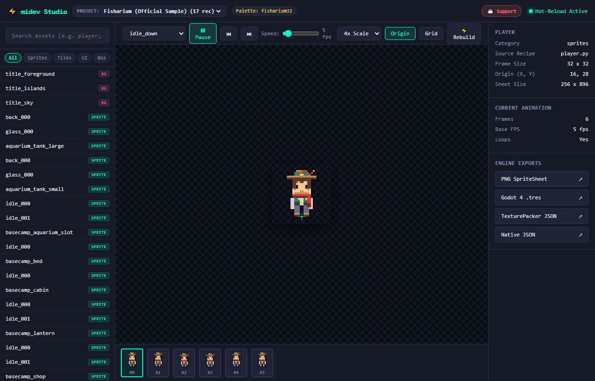
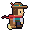
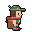
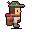
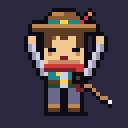

# midev-tools: Code-Generated Game Art Asset Toolkit

[](https://python.org)
[](tests/)
[](#)
[](tools/art/mcp_server.py)
[](https://ko-fi.com/midevfish)
[](https://trakteer.id/MiDevFish)
[](tools/art/)

`midev-tools` is a modular, standalone pixel art and vector asset generation toolkit for 2D game development.
Built on a **Dual-Audience Architecture**: powerful and lightweight for **human programmers** writing manual code, and natively optimized for **vibe coders & AI coding agents** (Claude, Cursor, Antigravity, Windsurf) through MCP and multimodal visual verification.

> [!NOTE]
> **Work in Progress**: It's not perfect yet and is still in active development. Features, APIs, and procedural tools are evolving continuously. Feedback, bug reports, and suggestions are warmly welcome!

---

## ⚡ Live Preview Studio

Interactive real-time web dashboard featuring animation playback controls, timeline frame-strip scrubbing, pixel origin inspection, multi-project switching, and live SSE hot-reloading:



---

## 🎮 Asset Showcase: `player` Character Rig

Every sprite, animation frame, and outline is generated 100% deterministically from code in [`samples/fisharium/recipes/player.py`](samples/fisharium/recipes/player.py). Mathematical limb swings, procedural bob offsets, and selective palette outlines ensure smooth and consistent retro-pixel motion.

| Idle (Down) | Walk Cycle | Run Cycle | Dash / Dodge | Dig Action | Fishing Catch |
| :---: | :---: | :---: | :---: | :---: | :---: |
|  |  |  |  |  |  |

---

## ⚖️ Why Code-Generated Art? (The Dual-Audience Advantage)

| Feature | Traditional AI (Midjourney/SD) | Hand-Drawn (Aseprite) | **midev-tools (Dual-Audience)** |
| :--- | :--- | :--- | :--- |
| **For Programmers** | ❌ Random pixels, no code control | ⏱️ Hours of manual pixel pushing | ✅ **100% Python Code & Math (`API_REFERENCE.md`)** |
| **For AI Agents** | ⚠️ Vague prompt lottery | ❌ Agents cannot use a mouse GUI | ✅ **Native Python recipes + MCP Server (`AGENTS.md`)** |
| **Style & Palette** | ❌ Inconsistent blur & bleed | ✅ Manual consistency | ✅ **Strict Deterministic snapping (0 bleeds)** |
| **Engine Metadata** | ❌ None (raw png, no frames) | ⚠️ Manual slicing & tagging | ✅ **Auto Godot 4 .tres, TexturePacker, Slices** |
| **Version Control** | ❌ Binary blobs cluttering Git | ❌ Binary `.ase` / `.psd` files | ✅ **Plain text Python scripts diffable in Git PRs** |
| **Visual Feedback** | ⏱️ Re-roll 50 times | ⏱️ Slow manual iteration | ⚡ **Multimodal Inspection (`midev inspect`) in seconds** |

---

## Key Features
- **100% Pure Python**: Fully cross-platform (Windows, Linux, macOS) with auto-venv bootstrapping and zero OS-shell scripts.
- **Multi-Project Workspace Architecture**:
  - Isolated game workspaces (`projects/<game_name>/`) separated from official sample references (`samples/fisharium/`).
  - Seamless project switching via CLI (`midev project use`) and live Web Studio dropdown.
- **Procedural Art Generator Library** (`tools/art/generators/`):
  - **Character**: Parametric humanoid rig (12 tracks: idle, walk, attack, hurt × 3 facings).
  - **Autotile**: 47-tile Wang blob set (3x3 minimal bitmask for Godot 4 & Tiled).
  - **VFX**: Radial explosions, water ripples, curved slashes, and magic sparkles.
  - **UI Kit**: 9-slice panels, HP/MP stat bars, inventory slots, and 3D buttons.
- **Deterministic Python Recipes**: Express character animations, tilesets, and UI as pure, diffable Python scripts.
- **Dual Pipeline (Raster & Vector)**:
  - *Raster*: `Canvas` API (`pixelkit.py`) for character sprites, frame sweeps, dithering, and 1px selective outlines.
  - *Vector*: SVG rendering (`resvg-py`) for crisp geometric props, UI frames, and layered backgrounds.
- **Universal Engine Exporters**:
  - **Godot 4**: Generates native `SpriteFrames` (`.tres`) ready for `AnimatedSprite2D`.
  - **TexturePacker JSON**: Standard Hash/Array format for Phaser, PixiJS, Unity, and Raylib.
  - **PNG Slices**: Individual frame sequences for Aseprite and frame-by-frame workflows.
- **Multi-Resolution Icon Generation & Testing Tools**:
  - Multi-resolution Windows `.ico` export (`Canvas.save_ico()`) supporting (16x16, 32x32, 48x48) with crisp nearest-neighbor downscaling.
  - Studio favicon generator (`python midev.py icon`) and built-in automated test suite (`python midev.py test`).
- **Multi-Palette & Procedural Theming**:
  - Supports `.hex`, `.gpl` (GIMP/Aseprite), and `.pal` files.
  - Presets: PICO-8, DB32, Endesga 32, Game Boy DMG, and Fisharium 32.
  - Real-time recoloring (`c.recolor()`), lighting tints (`c.tint()`), and color ramps (`make_ramp()`).
- **Live File Watcher & Incremental Build Cache**:
  - File watcher automatically re-renders and validates upon saving in your code editor.
  - SHA-256 content-addressed caching skips unchanged recipes for instantaneous builds.

---

## Quick Start

### 1. Environment Setup
Requires Python 3.12+.
```bash
python midev.py setup
```
*Note: `midev.py` automatically detects and runs inside `tools/.venv`. You never need to manually activate the virtual environment.*

Optional: Install as a direct CLI command:
```bash
pip install -e .
# Now you can simply type 'midev build' from anywhere in the project!
```

### 2. Workspace & Project Management
```bash
# List all registered projects and samples
python midev.py project list

# Create a new game project workspace
python midev.py project create my_rpg --palette pico8 --template rpg

# Switch active project
python midev.py project use my_rpg

# Show active or specific project info
python midev.py project info
```

### 3. Procedural Asset Generators
```bash
# Generate a humanoid character rig (hero)
python midev.py generate character --name hero

# Generate a 47-tile Wang blob autotile set for Godot / Tiled
python midev.py generate autotile --name dungeon_tiles

# Generate animated pixel VFX (explosion, ripple, slash, sparkle)
python midev.py generate vfx --name magic_fx

# Generate UI kit (9-slice panels, stat bars, slots, buttons)
python midev.py generate ui --name hud_kit
```

### 4. Build & Export Commands
```bash
# List all available recipes in active project
python midev.py list

# Build a single recipe
python midev.py build player

# Build all recipes in active project
python midev.py build

# Incremental build (skips recipes that haven't changed)
python midev.py build --incremental

# Force rebuild all recipes bypassing cache
python midev.py build --force

# Export specific engine formats (godot, texturepacker, slices, native, all)
python midev.py build player --format godot
python midev.py build player --format texturepacker
python midev.py build player --format slices
python midev.py build player --format all

# Export directly to external game engine directory
python midev.py build --out "F:/MyGodotGame/assets/sprites" --format godot

# Clean output directory before building
python midev.py build --clean

# Live Interactive Preview Studio (Web UI with animation controls & hot-reload)
python midev.py studio
python midev.py studio --port 8080
python midev.py studio --no-open

# Live File Watcher (auto-rebuilds and validates within milliseconds upon file save)
python midev.py watch
python midev.py watch player

# Multimodal Visual Verification Sheet (for human review and AI agent vision)
python midev.py inspect player
python midev.py inspect player --scale 4
python midev.py inspect player --json

# Start Model Context Protocol (MCP) Server for Cursor / Claude Desktop / Antigravity
python midev.py mcp

# Run automated test suite
python midev.py test

# Machine-Readable Structured Output (ideal for scripts & autonomous agents)
python midev.py build --json
python midev.py list --json
python midev.py doctor --json
python midev.py project list --json

# Generate / refresh studio favicon .ico
python midev.py icon

# System diagnostics & project info
python midev.py doctor
python midev.py info

# Palette management & inspection
python midev.py palette list
python midev.py palette inspect pico8
python midev.py palette inspect dawnbringer32

# Build with a specific palette (pico8, dawnbringer32, endesga32, gameboy4, fisharium32)
python midev.py build player --palette pico8
python midev.py build player --palette gameboy4

# Validate generated art assets
python midev.py validate
```

### 5. Documentation & Agent Guides
- 📖 [**Manual Programmer API Reference**](docs/API_REFERENCE.md): Complete guide to `pixelkit.Canvas`, `SheetBuilder`, math helpers, and SVG pipeline.
- 🤖 [**AI Agent Rules & Protocol**](AGENTS.md): Strict guidelines and multimodal verification loops for autonomous coding agents.
- 🎯 [**Cursor Configuration**](.cursorrules): Instant `.cursorrules` integration.

### 6. Git Management
```bash
python midev.py git status
python midev.py git info
python midev.py git sync -m "feat: add player fishing animation"
```

---

## Directory Structure
```
midev_art_tools/
├── midev.py                  # Root pure Python CLI runner (auto-venv bootstrapper)
├── pyproject.toml            # Standard PEP 621 Python package configuration
├── config/
│   └── midev.config.json     # Global pipeline configuration
├── samples/
│   └── fisharium/            # Official reference sample project
│       ├── config.json       # Sample-specific configuration
│       └── recipes/          # Sample recipes (player, chests, terrain, etc.)
├── projects/                 # Isolated workspaces for user game projects
│   └── demo_rpg/             # Example procedural RPG project
├── tests/                    # Automated test suite (test_ico.py, etc.)
├── tools/
│   ├── art/                  # Pipeline core engine
│   │   ├── artkit.py         # Main CLI engine
│   │   ├── pixelkit.py       # Canvas & raster graphics API
│   │   ├── palette_kit.py    # Palette loader & recolor system
│   │   ├── projects.py       # Multi-project workspace manager
│   │   ├── generators/       # Procedural generator library (character, autotile, vfx, ui)
│   │   ├── icon_gen.py       # Multi-resolution .ico favicon generator
│   │   ├── studio.py         # Interactive Live Preview Studio server
│   │   ├── web/              # Studio dashboard frontend (HTML/CSS/JS/favicon.ico)
│   │   ├── watcher.py        # Live file watcher & hot-reload engine
│   │   └── cache.py          # Content-addressed SHA-256 build cache
│   ├── .venv/                # Isolated virtual environment
│   └── requirements.txt      # Python dependencies
├── docs/
│   ├── ART_PIPELINE.md       # Pipeline architecture & style specifications
│   └── images/               # Documentation screenshots & showcase animations
└── README.md                 # Project documentation
```

---

## ☕ Support the Developer

If you find `midev-tools` helpful for your game development workflow or pixel art prototyping, consider supporting ongoing development:

[](https://ko-fi.com/midevfish)
[](https://trakteer.id/MiDevFish)

- ☕ **Ko-fi**: [https://ko-fi.com/midevfish](https://ko-fi.com/midevfish) (International - Card / PayPal)
- 🍨 **Trakteer**: [https://trakteer.id/MiDevFish](https://trakteer.id/MiDevFish) (Indonesia - QRIS, GoPay, OVO, Dana)

